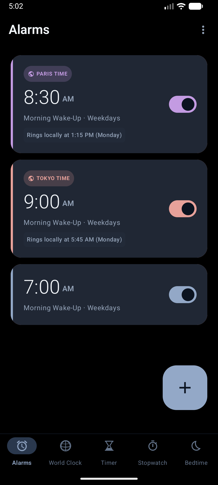
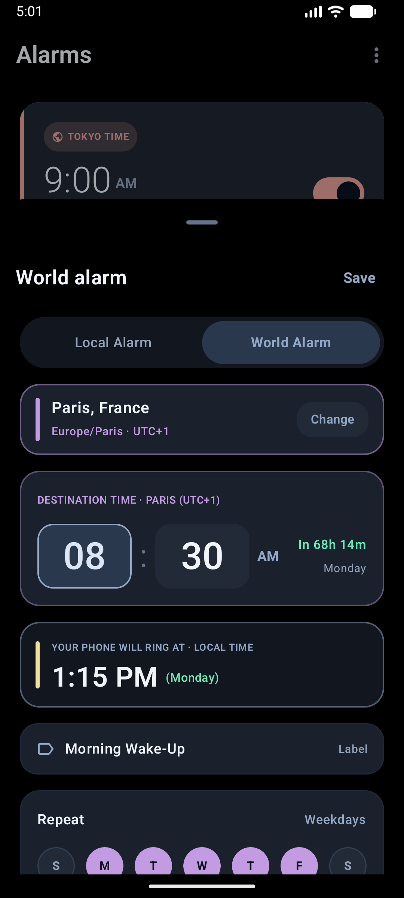
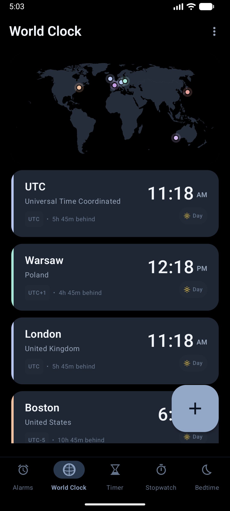
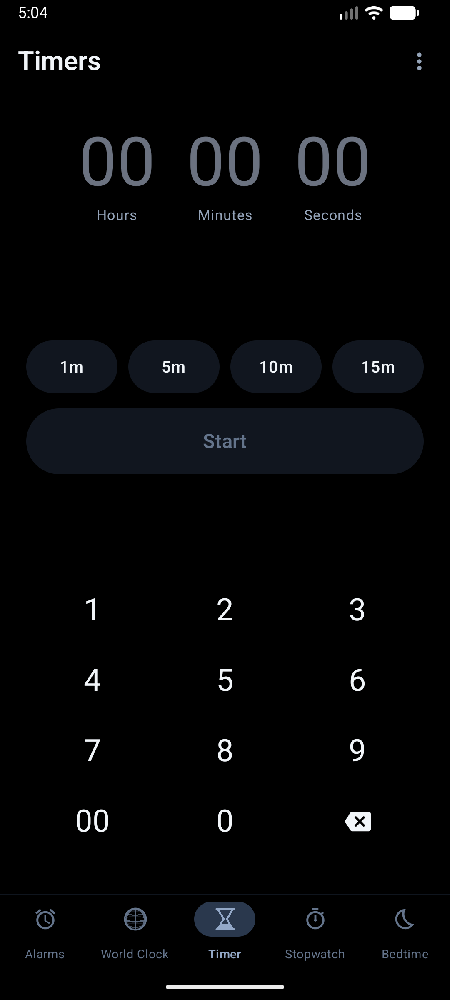
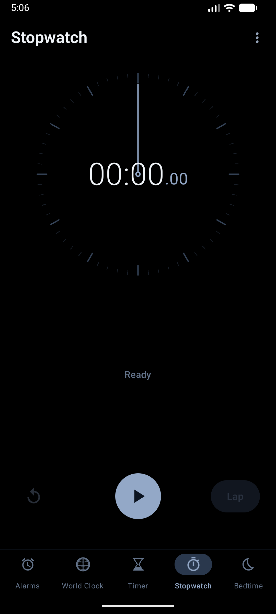
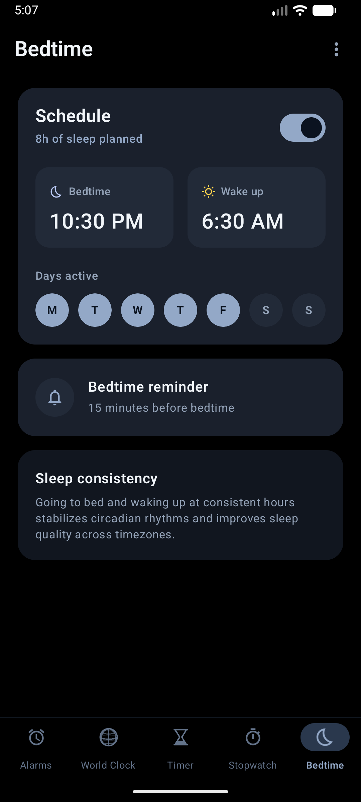
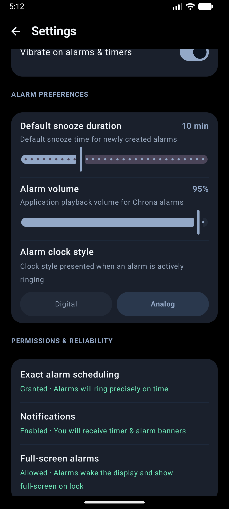

# Chrona

<p align="center">
  
</p>

<p align="center">
  <strong>Pixel-inspired world clock and cross-timezone alarm engine for Android.</strong>
</p>

<p align="center">
  
  
  
  
</p>

---

## ✦ Overview

Chrona is a native Android clock application designed with Material 3 and Pixel aesthetic sensibilities. Beyond standard timekeeping, Chrona solves distributed coordination with its **Cross-Timezone Alarm Engine**: schedule an alarm targeting local time in any destination city (e.g., 09:00 AM Tokyo or 08:30 AM Paris), and Chrona automatically maps, converts, and rings on your device at the exact local moment—dynamically handling daylight saving transitions (DST) via IANA `ZoneRules`.

---

## 📸 Visual Showcase

<p align="center">
  
  &nbsp;&nbsp;&nbsp;&nbsp;
  
  &nbsp;&nbsp;&nbsp;&nbsp;
  
</p>

<p align="center">
  <em>Left: Cross-timezone alarms (Paris, Tokyo, Local). Center: Real-time timezone conversion & destination scheduling. Right: Interactive Natural Earth world clock.</em>
</p>

<br/>

<p align="center">
  
  &nbsp;&nbsp;
  
  &nbsp;&nbsp;
  
  &nbsp;&nbsp;
  
</p>

<p align="center">
  <em>Left to right: Monotonic timer with presets, precision chronograph stopwatch, circadian bedtime schedule, and permissions & reliability settings.</em>
</p>

---

## ⚡ Core Capabilities

### 🌐 Cross-Timezone Alarm Scheduling
* **Target-City Time Input**: Set alarms in the destination city's clock time without manual conversions.
* **Dual-Time Preview**: Displays destination time alongside local trigger time and relative day offset (`Today`, `Monday`, `Tomorrow`).
* **Daylight Saving Resilience**: Backed by `java.time.ZonedDateTime` and IANA `ZoneRules`, automatically adjusting for DST boundary shifts.
* **Radial Material 3 Dial**: Tactile 12-hour / 24-hour radial clock picker for rapid time selection.

### 🔔 Reliable Full-Screen Alarm Presentation
* **Android 14+ Runtime Full-Screen Guard**: Checks `NotificationManager.canUseFullScreenIntent()`, waking the display and displaying `AlarmRingingActivity` over the lock screen (`turnScreenOn`, `showWhenLocked`, `FLAG_KEEP_SCREEN_ON`).
* **Graceful Fallback**: If full-screen intent is restricted, drops down cleanly to a high-priority heads-up notification with action buttons without crashing or foreground loops.
* **Acoustically Tuned Audio**: Single-owner `AlarmAudioService` using `USAGE_ALARM` and `CONTENT_TYPE_SONIFICATION` with a gentle 30-second volume ramp starting at an audible baseline (`0.25 × maxVolume`).

### 🗺️ Natural Earth World Clock
* **Interactive Cartographic Projection**: Natural Earth vector coordinates projected onto a theme-aware map canvas.
* **Instant City Inspection**: Tap pins to inspect local time, UTC offsets, and relative time differences.
* **Custom City Library**: Search and add cities across all global IANA time zones.

### ⏱️ Timers, Stopwatch & Bedtime
* **Multi-Timer Engine**: Keypad entry, quick presets (+1m, +5m, +10m, +15m), active progress ring, and continuous background notification alerts.
* **Chronograph Stopwatch**: 60fps sweep animation, precision tick markers, split times, and lap differentials.
* **Sleep Routine**: Target sleep consistency tracker with customizable wind-down reminders.

---

## 🏛️ Architecture

```
com.example.chrona/
├── core/
│   ├── alarm/          # AlarmScheduler, AlarmAudioService, AlarmReceiver, BootReceiver
│   ├── data/           # AlarmRepository, CityRepository, BedtimeRepository, PreferencesRepository
│   ├── database/       # ChronaDatabaseHelper, AlarmDao, SavedCityDao, TimerDao (SQLite)
│   ├── map/            # WorldMapComposable, WorldMapProjection, MapMarker
│   ├── model/          # Alarm, City, TimerItem, BedtimeSchedule, UserPreferences
│   └── timezone/       # TimezoneEngine, DST & UTC offset resolvers
├── feature/
│   ├── alarms/         # AlarmsScreen, CreateAlarmSheet, ChronaRadialTimePicker, AlarmRingingActivity
│   ├── bedtime/        # BedtimeScreen
│   ├── settings/       # SettingsScreen (Theme, Accents, Permissions & Reliability)
│   ├── stopwatch/      # StopwatchScreen, StopwatchManager
│   ├── timer/          # TimerScreen, TimerManager
│   └── worldclock/     # WorldClockScreen, CityDetailSheet, AddCitySheet
├── navigation/         # ChronaNavHost, Bottom navigation with animated indicators
└── ui/theme/           # Material 3 tokens, AMOLED dark & light color schemes, typography
```

* **Modern Stack**: 100% Jetpack Compose, Kotlin Coroutines & Flow, Material 3.
* **State Management**: Unidirectional Data Flow (UDF) with lifecycle-aware state observation (`collectAsStateWithLifecycle`).
* **Persistence**: Structured local SQLite storage with Jetpack DataStore preferences.

---

## 🔒 Permissions & System Integration

| Permission | API Level | Purpose |
|:---|:---|:---|
| `USE_FULL_SCREEN_INTENT` | API 34+ | Presents full-screen alarm over lock screen with runtime fallback to heads-up alert. |
| `SCHEDULE_EXACT_ALARM` | API 31+ | Schedules exact millisecond alarm triggers via Android `AlarmManager`. |
| `POST_NOTIFICATIONS` | API 33+ | Posts ongoing timer status and alarm alert banners. |
| `FOREGROUND_SERVICE_MEDIA_PLAYBACK` | API 34+ | Keeps alarm audio playback active and uninterrupted by OS task killing. |
| `RECEIVE_BOOT_COMPLETED` | All | Reschedules alarms and bedtime notifications on device reboot. |

---

## 🛠️ Building & Running

```bash
# Clone the repository
git clone https://github.com/your-username/chrona.git
cd chrona

# Run unit tests
./gradlew testDebugUnitTest

# Assemble debug APK
./gradlew assembleDebug

# Install on connected device/emulator
adb install -r app/build/outputs/apk/debug/app-debug.apk
```

---

## 📄 License

Licensed under the [Apache License, Version 2.0](LICENSE).
